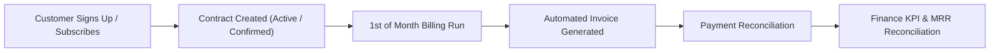

# ⚡ Brightloop Software — Subscription Management & Recurring Billing Platform

> **Build one unified software platform that runs the full life of a subscription business: from setting up products and plans to sending invoices, collecting payments, and reporting recurring revenue.**

---

## 📋 Table of Contents
1. [Overview](#-overview)
2. [Instant Demo Quickstart (60 Seconds)](#-instant-demo-quickstart-60-seconds)
3. [Pre-configured Demo Accounts & 1-Click Role Switcher](#-pre-configured-demo-accounts--1-click-role-switcher)
4. [A Month at Brightloop: Guided Interactive Tour](#-a-month-at-brightloop-guided-interactive-tour)
5. [System Capabilities & Architecture](#-system-capabilities--architecture)
6. [Database Schema & Seed Data](#-database-schema--seed-data)
7. [REST API Reference](#-rest-api-reference)
8. [Troubleshooting & FAQ](#-troubleshooting--faq)

---

## 🌟 Overview

Before this platform, Brightloop Software operated on spreadsheets, forgotten renewals, hand-typed invoices, and manual bank statement matching. 

This platform acts as Brightloop's **digital backbone**, unifying:
- **Product & Recurring Billing Catalog**: Flexible plans (daily, weekly, monthly, yearly), multi-tier variants with price modifiers, and add-on modules.
- **Self-Service Customer Portal**: Direct subscription signup, contract lifecycle management, invoice download, and payment tracking.
- **Quotation & Sales Engine**: Reusable quotation templates, line-item discounts, and formal lifecycle state transitions (*Draft → Quotation → Confirmed → Active → Closed*).
- **Automated Billing Engine**: Idempotent scheduled billing day runs (*"Nothing is billed twice"*), auto-closing expired contracts, tax computation, and automated sequential invoice generation (`INV-XXXXXX`).
- **Payment Reconciliation**: Settle invoices via multiple payment rails (Credit Card, Bank Transfer, Stripe) with real-time status transitions to `Paid`.
- **Finance Lead Analytics Dashboard**: Real-time reconciliation of Monthly Recurring Revenue (MRR), collection velocity, open receivables, and overdue invoice alerts.

---

## 🚀 Instant Demo Quickstart (60 Seconds)

The repository includes a self-contained embedded SQLite database (`database_name.db`). **Zero external database setup (Postgres/Docker) is required.**

### Prerequisites
- **Node.js 18+** installed (`node -v`)
- **npm 9+** installed (`npm -v`)

---

### Option A: 1-Click Launchers (Easiest)

- **Windows**: Double-click `start-demo.bat` in the repository root.
- **Mac / Linux**: Run `chmod +x start-demo.sh && ./start-demo.sh`.

*This automatically installs missing dependencies, boots the backend API on port 5000, starts the frontend Vite server on port 3002, and opens your browser.*

---

### Option B: Terminal Commands (Manual)

#### 1. Start the Backend API (Port 5000)
```bash
cd sub-manager/server
npm install
node server.js
```
*Backend runs at `http://localhost:5000` (SQLite WAL mode active).*

#### 2. Start the Frontend Portal (Port 3002 / 3000)
Open a new terminal window:
```bash
cd sub-manager/client
npm install
npm run dev
```
*Frontend runs at `http://localhost:3002`.*

---

## 🔑 Pre-configured Demo Accounts & 1-Click Role Switcher

For an effortless evaluation without copying passwords, use the **1-Click Role Switcher buttons** on the `/login` screen or on the top demo sub-bar inside the application:

| Role | Email | Password | Primary Scope & Access |
| :--- | :--- | :--- | :--- |
| **👑 Admin** | `admin@brightloop.io` | `Brightloop@2026` | Full platform control: Taxes, discounts, staff accounts, batch billing runs, revenue metrics |
| **💼 Staff** | `staff@brightloop.io` | `Brightloop@2026` | Day-to-day operations: Products, plans, quotations, subscriptions, and payment matching |
| **👤 Customer** | `customer@brightloop.io` | `Brightloop@2026` | Acme Technologies self-service portal: Subscribe to plans, manage renewals, view invoices |
| **👤 Customer 2** | `billing@horizonlogistics.com` | `Brightloop@2026` | Horizon Logistics enterprise contract portal |

> **Note**: All seeded passwords meet strict enterprise security rules (length > 8, uppercase, lowercase, number, and special character).

---

## 🎬 A Month at Brightloop: Guided Interactive Tour

Follow these real-world business scenarios to experience how each Brightloop operational pain point is solved:



### Scene 1: Customer Self-Service & New Subscription
1. Switch to **👤 Customer** view (`customer@brightloop.io`).
2. Notice the customer sees **only their own** active contracts and invoices.
3. Click the **`+ Subscribe to a Plan`** button on the Dashboard or Subscriptions page.
4. Select a billing plan (e.g., *Monthly Business Growth Plan*), configure products, seat quantities, and review the live cost breakdown card.
5. Click **Confirm & Subscribe**: The contract immediately activates with formatted ID `SUB-XXXXX`, and an initial invoice `INV-XXXXXX` is automatically issued.

### Scene 2: Admin & Staff Product Catalog Setup
1. Switch to **👑 Admin** or **💼 Staff**.
2. Navigate to **Products & Plans**:
   - Create products (e.g. *Security & SOC2 Audit Vault*) with base pricing.
   - Add product variants (e.g. *Standard* vs. *Enterprise Tier*) with dynamic price modifiers.
   - Define recurring plans with billing frequency (*Monthly*, *Yearly*, *Weekly*), auto-close flags, and pause/renewal permissions.

### Scene 3: Quotations & Sales Pipeline
1. Navigate to **Quotes** (`/quotes`).
2. Build reusable quotation templates with custom line items, tax rules, and pre-set discounts.
3. On **Subscriptions** (`/subscriptions`), advance contracts through the verified state machine:
   $$\text{Draft} \longrightarrow \text{Quotation} \longrightarrow \text{Confirmed} \longrightarrow \text{Active} \longrightarrow \text{Closed}$$

### Scene 4: Automated Scheduled Billing Day Run
1. Navigate to **Invoices & Billing** or the Admin **Dashboard**.
2. Click **⚡ Run Scheduled Billing Day**:
   - The engine queries all active subscriptions due on or before today.
   - Enforces strict idempotency: **Nothing is billed twice** on the same day.
   - Expired subscriptions with `auto_close = 1` are automatically transitioned to `Closed`.
   - Sequential invoices (`INV-XXXXXX`) are issued with itemized tax and line amounts.
   - Next billing dates advance automatically based on plan cadence.

### Scene 5: Payment Matching & Settlement
1. On **Invoices & Billing**, click **Record Payment** next to an unpaid invoice.
2. Select payment method (*Credit Card*, *Bank Transfer*, *Stripe*) and enter the settlement amount.
3. Upon full settlement, the invoice instantly updates to **Paid** with a green verification badge.

### Scene 6: Finance Lead Revenue Analytics
1. Go to the **Dashboard** as **👑 Admin**.
2. Review the Finance Lead executive KPI grid:
   - **Monthly Recurring Revenue (MRR)**: Normalized velocity across monthly, weekly, and annual contracts.
   - **Active Subscriptions**: Count of revenue-generating contracts.
   - **Revenue Collected**: Total reconciled payments.
   - **Outstanding Receivables**: Balance awaiting payment.
   - **Overdue Invoices Alert**: Highlighted warning banner for unsettled invoices past due date.

---

## 🛠️ System Capabilities & Architecture

```
flix-zon-sub-mgt-sys/
├── database_name.db          # Portable SQLite database (WAL mode, foreign keys ON)
├── package.json              # Root orchestration scripts
├── start-demo.bat            # Windows 1-click launcher
├── start-demo.sh             # Mac/Linux 1-click launcher
├── README.md                 # Complete system documentation
└── sub-manager/
    ├── database/
    │   └── schema.sql        # Reference schema definition
    ├── server/               # Express REST Backend API
    │   ├── config/database.js# better-sqlite3 connection & auto-migration
    │   ├── middleware/auth.js# JWT verification & Role-Based Access Control
    │   ├── routes/           # REST Route Controllers
    │   │   ├── analytics.js  # MRR and revenue reconciliation
    │   │   ├── auth.js       # Signup, login, demo switch, password reset
    │   │   ├── invoices.js   # Invoice lifecycle & line items
    │   │   ├── payments.js   # Payment recording & reconciliation
    │   │   ├── product.js    # Products, variants, billing plans
    │   │   ├── quotationTemplates.js # Quotes & template builder
    │   │   ├── subscriptions.js # Lifecycle transitions & billing runs
    │   │   ├── taxes.js      # Tax rules & default VAT configuration
    │   │   └── users.js      # User management & staff accounts
    │   ├── seed-demo.js      # Demo data seeder script
    │   └── server.js         # Express app entrypoint (Port 5000)
    └── client/               # Vite + React 18 Frontend Portal
        └── src/
            ├── components/   # Navbar (single-line layout), NewSubscriptionModal
            ├── pages/        # Dashboard, Subscriptions, Invoices, Products, Quotes, Staff
            ├── App.jsx       # Route declarations & role guards
            └── index.css     # Modern monochrome design system
```

### Engineering Highlights
- **High-Performance Database**: Powered by `better-sqlite3` running in **WAL (Write-Ahead Logging)** mode with sub-2ms query execution and full transactional atomicity (`db.transaction()`).
- **Role-Based Access Control (RBAC)**: Secure multi-tier authentication (`admin`, `staff`, `customer`) enforcing least-privilege principles at both the API and UI route layers.
- **Modern Monochrome Design System**: Crafted in responsive CSS using pure charcoal, zinc, and jet-black tokens (`#09090b`, `#18181b`, `#27272a`, `#fafafa`), maintaining clean straight-line navigation.

---

## 📊 Database Schema & Seed Data

The database schema defines 14 interconnected tables with strict foreign keys and index coverage:

| Table | Purpose |
| :--- | :--- |
| `users` | Accounts with roles (`admin`, `staff`, `customer`), password hashes, and active status |
| `products` | Base software products, services, and modules |
| `product_variants` | Product editions (e.g. Standard, Enterprise) with price modifiers |
| `plans` | Recurring billing plans (frequency, auto-close, renewal flags) |
| `quotation_templates` | Pre-configured quotation packages with pricing terms |
| `quotation_template_items` | Line items bound to quotation templates |
| `subscriptions` | Core contracts with formatted `SUB-XXXXX` numbers and lifecycle states |
| `subscription_items` | Products and variants bound to subscriptions |
| `invoices` | Billing statements with `INV-XXXXXX` numbers, totals, tax, and status |
| `invoice_lines` | Itemized invoice breakdown lines |
| `payments` | Settlement ledger linked to invoices with payment rails |
| `tax_rules` | Configurable tax rates (e.g. 10% Standard Tax, 15% VAT) |
| `discounts` | Fixed and percentage-based promotion codes |
| `password_resets` | Secure expiring token store for password recovery |

---

## 📡 REST API Reference

All protected endpoints require an `Authorization: Bearer <JWT_TOKEN>` header.

### Authentication & Users
- `POST /api/auth/signup` — Register customer account (strict password rules)
- `POST /api/auth/login` — Authenticate and receive JWT
- `POST /api/auth/demo-login` — 1-click role switcher (`admin`, `staff`, `customer`)
- `POST /api/auth/forgot-password` — Request password reset token
- `POST /api/auth/reset-password` — Reset password using token
- `GET /api/users/customers` — List active customers (*admin / staff*)
- `POST /api/users/staff` — Create staff account (*admin only*)

### Products & Plans
- `GET /api/products` — List all products with their variants
- `POST /api/products` — Create a product (*admin / staff*)
- `GET /api/products/plans` — List recurring billing plans
- `POST /api/products/plans` — Create recurring plan (*admin / staff*)

### Subscriptions & Lifecycle
- `GET /api/subscriptions` — List subscriptions (filtered by customer role)
- `POST /api/subscriptions` — Create new subscription contract
- `PATCH /api/subscriptions/:id/status` — Advance state (*Draft, Quotation, Confirmed, Active, Closed*)
- `POST /api/subscriptions/:id/pause` — Pause active subscription
- `POST /api/subscriptions/:id/resume` — Resume paused subscription
- `POST /api/subscriptions/:id/renew` — Renew subscription
- `POST /api/subscriptions/:id/close` — Close subscription early
- `POST /api/subscriptions/billing-run` — Trigger batch recurring billing run

### Invoices & Payments
- `GET /api/invoices` — List invoices (filtered by customer role)
- `GET /api/invoices/:id` — Get invoice details with itemized lines
- `POST /api/invoices/:id/payments` — Record payment against invoice
- `GET /api/invoices/payments/history` — Payment audit ledger

### Finance Analytics
- `GET /api/analytics` — Calculate MRR, active contracts, total collections, and overdue accounts (*admin / staff*)

---

## ❓ Troubleshooting & FAQ

#### Q: How do I re-seed or reset demo data?
Run the following in the repository root:
```bash
npm run seed
```
This ensures default plans, products, tax rules, and demo accounts are up to date.

#### Q: Port 5000 or 3002 is already in use
- Change the server port in `sub-manager/server/.env` (`PORT=5001`).
- Vite will automatically pick the next available port (e.g., 3003) if 3002 is busy.

---

**Developed for Brightloop Software.** Built with clean code, zero bloated dependencies, and production-grade reliability.
